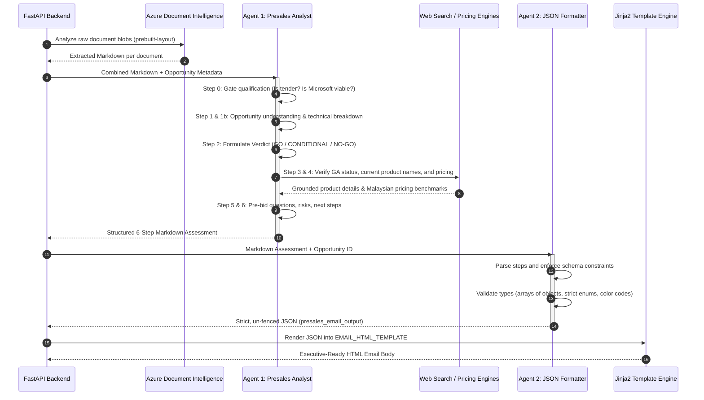

# Enfrasys Presales Agentic AI

[](https://fastapi.tiangolo.com)
[](https://www.python.org)
[](https://azure.microsoft.com/en-us/products/ai-services/ai-document-intelligence)
[](https://ai.azure.com)
[](https://www.docker.com)
[](https://www.enfrasys.com)

An enterprise-grade **Agentic AI Decision & Presales Acceleration Engine** built for **Enfrasys Consulting Sdn Bhd** (Premier Microsoft Solutions Partner). The system automatically ingests, extracts, analyzes, and evaluates complex public and private sector tender and RFP (Request for Proposal) document packages, producing decisive **GO / CONDITIONAL / NO-GO** recommendations, Microsoft-first solution architectures, cost breakdowns in Malaysian Ringgit (MYR), risk matrices, and executive email briefs.

---

## Table of Contents

- [Overview](#overview)
- [System Architecture](#system-architecture)
- [Multi-Agent Pipeline](#multi-agent-pipeline)
  - [Agent 1: Presales Analyst Agent](#agent-1-presales-analyst-agent)
  - [Agent 2: HTML/JSON Formatter Agent](#agent-2-htmljson-formatter-agent)
- [End-to-End Orchestration Flow](#end-to-end-orchestration-flow)
- [Repository Structure](#repository-structure)
- [API Reference](#api-reference)
  - [Health & Diagnostics](#health--diagnostics)
  - [Blob Storage & Document Management](#blob-storage--document-management)
  - [Document Extraction (Async)](#document-extraction-async)
  - [Presales AI Analysis (Async)](#presales-ai-analysis-async)
  - [HTML Email Rendering](#html-email-rendering)
- [Environment Configuration](#environment-configuration)
- [Installation & Local Setup](#installation--local-setup)
- [Docker & Deployment Guide](#docker--deployment-guide)
- [Data Samples & Benchmarks](#data-samples--benchmarks)
- [Resilience & Production Hardening](#resilience--production-hardening)
- [Future Roadmap](#future-roadmap)

---

## Overview

Evaluating multi-hundred-page enterprise tenders (RFPs, specifications, compliance appendixes, and terms) is typically labor-intensive, error-prone, and slow. As a Microsoft Partner, Enfrasys maintains specialized delivery capabilities focused on Microsoft cloud, hybrid infrastructure, security, data platforms, and licensing. 

The **Enfrasys Presales Agentic AI** automates and standardizes this evaluation process by:
1. **Qualifying Tender Intent**: Distinguishing real procurement documents from non-tender material (marketing brochures, whitepapers, manuals).
2. **Validating Microsoft Opportunity**: Determining whether the tender contains a viable Microsoft-first scope (Azure, Microsoft Foundry, Fabric, Power BI, Power Platform, M365, on-premises/hybrid, or licensing) without forcing Microsoft onto non-viable competitor mandates.
3. **Evaluating Partner-Led Options**: Analyzing whether competitor-mandated tenders (e.g., AWS/GCP) are viable via a consortium or subcontractor model with an authorized cloud partner while Enfrasys leads Project Management, QA, or Microsoft integrations.
4. **Synthesizing Technical Scope**: Extracting granular technical dimensions (use cases, data governance, AI patterns like RAG, SLAs, security controls).
5. **Architecting Solutions**: Recommending an official, current Microsoft-first technology stack with solution-to-problem mapping, backed by real-time web search verification.
6. **Estimating Costs in MYR**: Providing a realistic budgetary range across development, infrastructure, licensing, and ongoing maintenance.
7. **Generating Pre-Bid Questionnaires**: Identifying ambiguities, missing criteria, and risks to address before committing commercial resources.
8. **Rendering Executive Email Deliverables**: Injecting structured results into a responsive, branded HTML email template for immediate dispatch to sales leaders and practice leads via Power Automate.

---

## System Architecture

The following diagram illustrates how external interfaces (Microsoft Copilot Studio, SharePoint, Power Automate), cloud storage, cognitive services, multi-agent frameworks, and email notifications interact:

```mermaid
flowchart TD
    subgraph ClientLayer["User Interface & Orchestration Layer"]
        A[User / Presales Consultant] -->|Upload Tender Package| B[Microsoft Copilot Studio / SharePoint]
        B -->|Trigger Ingestion| C[Microsoft Power Automate Flow]
    end

    subgraph StorageLayer["Azure Cloud Storage"]
        D[(Azure Blob Storage\nContainer: dev-opportunity-documents)]
        B -->|Store Raw Files\nPDF, DOCX, XLSX| D
    end

    subgraph FastAPILayer["Enfrasys Presales Agent Backend (FastAPI)"]
        direction TB
        E[FastAPI API Gateway]
        F[Background Task Worker]
        G[In-Memory Job Manager\nEXTRACT_JOBS & JOBS]
        H[Jinja2 HTML Rendering Engine]
        
        E <--> G
        E --> F
        F --> H
    end

    subgraph CognitiveLayer["Azure AI Cognitive & Agent Services"]
        I[Azure AI Document Intelligence\nprebuilt-layout model]
        J[Azure AI Foundry Responses API]
        K[Agent 1: Presales Analyst\nGrounding + Web Search]
        L[Agent 2: HTML/JSON Formatter\nStrict Schema Validation]
        
        J --> K
        K -->|Presales Markdown| L
    end

    subgraph NotificationLayer["Output Delivery"]
        M[Executive Outlook Email]
    end

    %% Flow interactions
    C -->|1. POST /extract-document/{opportunity_id}| E
    F -->|Download Blobs| D
    F -->|Layout Extraction Stream| I
    I -->|Markdown Document Parts| F
    C -->|2. Poll /status & Fetch /result| E

    C -->|3. POST /analyze-opportunity| E
    F -->|Payload & Markdown| J
    L -->|Structured email_json| F
    C -->|4. Poll /status & Fetch /result| E

    C -->|5. POST /convert-html| E
    H -->|Subject + Responsive HTML| E
    E -->|Final Envelope Payload| C
    C -->|6. Send Email via Office 365| M
```

---

## Multi-Agent Pipeline

The core intelligence layer uses a sequential two-agent chain orchestrated through Azure AI Foundry's Responses API (`openai_client.responses.create` with `agent_reference`).



### Agent 1: Presales Analyst Agent

Defined in [`backend-fastapi-dev/presales-analyst-agent-prompt.txt`](file:///c:/Users/MuhammadIdzhansKhair/enfrasys-projects/project-internal/internal-enfrasys-presales-agent/backend-fastapi-dev/presales-analyst-agent-prompt.txt). 

Act as a **Senior Microsoft-Certified Solution Architect** for Malaysian public and private sector tenders:
- **STEP 0 — Gate Qualification**:
  - Validates whether the document represents an actual procurement request.
  - Determines if there is a legitimate Microsoft opportunity (cloud, on-prem, hybrid, or licensing).
  - Explicit rule: **Never force Microsoft onto a competitor-mandated tender (e.g. AWS/GCP).** If a competitor platform is mandated, evaluate whether a **Partner-Led approach** is viable.
- **STEP 1 — Opportunity Summary**: Extracts client name, industry, sector, project title, budget, deadlines, and a concise 2–3 sentence **Problem Statement**.
- **STEP 1b — Technical Breakdown (`client_requirements`)**: In-depth analysis of mandatory technical dimensions (use cases, data sources, RAG patterns, governance, security thresholds).
- **STEP 2 — Verdict Reasoning**:
  - `GO`: Direct Microsoft fit, realistic scope, Enfrasys delivers core solution.
  - `CONDITIONAL`: Viable Microsoft opportunity with missing scope details or split delivery.
  - `NO-GO`: Not a tender, zero Microsoft fit, or unworkable competitor mandate.
  - **Partnership Outlook**: Detailed analysis of partner requirements, Enfrasys' co-delivery role (PM/QA/Microsoft scope), and consortium legality.
- **STEP 3 — Recommended Tech Stack & Solution Mapping**:
  - Microsoft-First stack items with Product Name, Functional Purpose, and Client-Specific Justification.
  - External stack items (if required or partner-led).
  - Solution mapping explaining how the architecture solves the customer's problem.
- **STEP 4 — Estimated Cost**: Realistic cost range in Malaysian Ringgit (MYR), itemized across Development, Infrastructure, Licensing, and Maintenance.
- **STEP 5 — Client Questionnaire**: Crucial technical and commercial questions Enfrasys must ask prior to bidding.
- **STEP 6 — Final Decision Matrix**: Confidence level (High/Medium/Low), top 3 reasons, top 3 risks, and 3 immediate next steps.

### Agent 2: HTML/JSON Formatter Agent

Defined in [`backend-fastapi-dev/html-json-formatter-agent-prompt.txt`](file:///c:/Users/MuhammadIdzhansKhair/enfrasys-projects/project-internal/internal-enfrasys-presales-agent/backend-fastapi-dev/html-json-formatter-agent-prompt.txt) and [`backend-fastapi-dev/html-json-formatter-agent-schema.txt`](file:///c:/Users/MuhammadIdzhansKhair/enfrasys-projects/project-internal/internal-enfrasys-presales-agent/backend-fastapi-dev/html-json-formatter-agent-schema.txt).

Converts Agent 1's analytical assessment into a clean JSON structure:
- Strips markdown code blocks and conversational commentary.
- Enforces strict enum values: `verdict` (`GO`, `CONDITIONAL`, `NO-GO`), `verdict_color` (`green`, `amber`, `red`), `segment` (`Public Sector`, `Private Sector`, `Unknown`).
- Converts tech stacks into arrays of structured objects (`{ name, purpose, justification }`).
- Converts questionnaires into arrays of `{ question, reason }`.
- Sanitizes references (only complete, validated HTTP/HTTPS URLs).
- Handles `NO-GO` edge cases (correctly resets tech stack, cost, and questionnaire arrays to empty sets when no partner is viable).

---

## End-to-End Orchestration Flow

1. **Upload**: A presales engineer uploads tender files (e.g. `RFP.pdf`, `Appendix_2.xlsx`) to Azure Blob Storage under `{CONTAINER_NAME}/{opportunity_id}/`.
2. **Extraction Initiation**: Power Automate triggers `POST /extract-document/{opportunity_id}`. A background job downloads each blob in memory and executes `prebuilt-layout` via Azure Document Intelligence.
3. **Extraction Polling**: Power Automate polls `GET /extract-document/{job_id}/status` until status is `completed`.
4. **Extraction Retrieval**: Power Automate calls `GET /extract-document/{job_id}/result` to receive the combined Markdown and metadata (page counts, table counts, skipped files).
5. **Analysis Initiation**: Power Automate posts the extracted Markdown and opportunity metadata to `POST /analyze-opportunity`.
6. **Analysis Polling**: Power Automate polls `GET /analyze-opportunity/{job_id}/status` every 15 seconds. Token consumption (input, output, cached) is tracked in real-time.
7. **Analysis Retrieval**: When status is `completed`, `GET /analyze-opportunity/{job_id}/result` returns the structured `email_json`.
8. **HTML Conversion**: Power Automate posts `email_json` to `POST /convert-html`. Jinja2 injects the data into `EMAIL_HTML_TEMPLATE`, producing an executive HTML email with the subject line `[AI Presales Review] {opportunity_title}`.
9. **Dispatch**: Power Automate delivers the email to relevant account managers and practice leads.

---

## Repository Structure

```text
internal-enfrasys-presales-agent/
│
├── README.md                                 # Master project documentation
├── docker-command.txt                        # Docker build & push instructions
├── send.txt                                  # Sample end-to-end extraction & analysis debug log
├── .gitignore                                # Git ignore rules (.env, __pycache__, data-sample, etc.)
│
├── backend-fastapi-dev/                      # Active development environment
│   ├── app_dev.py                            # FastAPI application (routes, background workers, Jinja2 template)
│   ├── presales-analyst-agent-prompt.txt     # System prompt for Agent 1 (Solution Architect)
│   ├── html-json-formatter-agent-prompt.txt  # System prompt for Agent 2 (JSON Formatter)
│   ├── html-json-formatter-agent-schema.txt  # Strict JSON Schema definition for Agent 2
│   ├── requirements.txt                      # Python dependencies for development
│   └── .env                                  # Environment variables (ignored by git)
│
├── backend-fastapi-test/                     # Staged test & container deployment workspace
│   ├── app_test.py                           # FastAPI test service entry point
│   ├── Dockerfile                            # Dockerfile for test container
│   ├── .dockerignore                         # Docker build exclusion rules
│   └── requirements.txt                      # Runtime dependencies for test container
│
├── backend-fastapi-prod/                     # Production deployment workspace
│   ├── app.py                                # Production service entry point
│   ├── Dockerfile                            # Dockerfile for production container
│   └── requirements.txt                      # Runtime dependencies for production
│
├── data-sample/                              # Benchmark RFP documents and rendered outputs (ignored by git)
│   ├── input/                                # Sample RFPs (PDF, XLSX, DOCX) from EPF, LZS, JAKIM, etc.
│   │   ├── dev-pdfxlsx-.../                  # Combined PDF and XLSX test cases
│   │   └── dev-three-differ-.../             # Multi-document test sets
│   └── output/                               # Sample rendered HTML deliverables
│       ├── preview.html                      # Standalone HTML email preview
│       └── sample-presales-agent-output.html # Full rendered presales report
│
└── frontend-ui/                              # Planned web interface workspace
    └── README.md                             # UI roadmap and placeholder
```

### Key Files & Workspaces

| File / Component | Link | Description |
|---|---|---|
| **Development App** | [`app_dev.py`](file:///c:/Users/MuhammadIdzhansKhair/enfrasys-projects/project-internal/internal-enfrasys-presales-agent/backend-fastapi-dev/app_dev.py) | Full development FastAPI app with background workers, Jinja2 template, and Azure service integration |
| **Presales Analyst Prompt** | [`presales-analyst-agent-prompt.txt`](file:///c:/Users/MuhammadIdzhansKhair/enfrasys-projects/project-internal/internal-enfrasys-presales-agent/backend-fastapi-dev/presales-analyst-agent-prompt.txt) | Detailed system prompt guiding Agent 1's 6-step presales evaluation |
| **JSON Formatter Prompt** | [`html-json-formatter-agent-prompt.txt`](file:///c:/Users/MuhammadIdzhansKhair/enfrasys-projects/project-internal/internal-enfrasys-presales-agent/backend-fastapi-dev/html-json-formatter-agent-prompt.txt) | System prompt enforcing strict JSON output transformation for Agent 2 |
| **JSON Formatter Schema** | [`html-json-formatter-agent-schema.txt`](file:///c:/Users/MuhammadIdzhansKhair/enfrasys-projects/project-internal/internal-enfrasys-presales-agent/backend-fastapi-dev/html-json-formatter-agent-schema.txt) | Formal JSON Schema definition for presales evaluation payload |
| **Dev Requirements** | [`requirements.txt`](file:///c:/Users/MuhammadIdzhansKhair/enfrasys-projects/project-internal/internal-enfrasys-presales-agent/backend-fastapi-dev/requirements.txt) | Python dependencies for development runtime |
| **Test Service App** | [`app_test.py`](file:///c:/Users/MuhammadIdzhansKhair/enfrasys-projects/project-internal/internal-enfrasys-presales-agent/backend-fastapi-test/app_test.py) | Test/staging version of the FastAPI application |
| **Test Dockerfile** | [`Dockerfile (test)`](file:///c:/Users/MuhammadIdzhansKhair/enfrasys-projects/project-internal/internal-enfrasys-presales-agent/backend-fastapi-test/Dockerfile) | Container definition for test image `idzhans01/enfrasys-presales-agent:test` |
| **Prod Dockerfile** | [`Dockerfile (prod)`](file:///c:/Users/MuhammadIdzhansKhair/enfrasys-projects/project-internal/internal-enfrasys-presales-agent/backend-fastapi-prod/Dockerfile) | Container definition for production image |
| **Docker CLI Commands** | [`docker-command.txt`](file:///c:/Users/MuhammadIdzhansKhair/enfrasys-projects/project-internal/internal-enfrasys-presales-agent/docker-command.txt) | Quick commands for building and pushing Docker images |
| **Sample Output Preview** | [`preview.html`](file:///c:/Users/MuhammadIdzhansKhair/enfrasys-projects/project-internal/internal-enfrasys-presales-agent/data-sample/output/preview.html) | Standalone preview of generated executive HTML email |
| **Test Run Payload** | [`send.txt`](file:///c:/Users/MuhammadIdzhansKhair/enfrasys-projects/project-internal/internal-enfrasys-presales-agent/send.txt) | Sample extraction output and live tender test data log |


---

## API Reference

### Health & Diagnostics

#### `GET /`
Returns the operational status of the service and the configured blob container name.
```json
{
  "service": "Enfrasys Pre-Sales Agent",
  "status": "running",
  "container": "dev-opportunity-documents"
}
```

#### `GET /health`
Standard Kubernetes/container liveness probe.
```json
{
  "status": "healthy"
}
```

---

### Blob Storage & Document Management

#### `GET /download-document/{opportunity_id}/{file_name}`
Streams the raw document from Azure Blob Storage with appropriate MIME headers (`application/pdf`, `application/vnd.openxmlformats-officedocument.spreadsheetml.sheet`, etc.).

#### `GET /document-info/{opportunity_id}/{file_name}`
Fetches document metadata without downloading file bytes.
- **Response**:
```json
{
  "opportunity_id": "59b94662-bf64-429b-99f8-44999a9d8066",
  "file_name": "RFP 2026 - IDP 1.3.pdf",
  "blob_path": "59b94662-bf64-429b-99f8-44999a9d8066/RFP 2026 - IDP 1.3.pdf",
  "size_bytes": 1222069,
  "content_type": "application/pdf",
  "last_modified": "2026-08-01T10:14:22+00:00",
  "etag": "\"0x8DB8FE...\""
}
```

#### `GET /list-documents/{opportunity_id}`
Lists all files stored under the specified opportunity directory.

---

### Document Extraction (Async)

#### `POST /extract-document/{opportunity_id}`
Triggers an asynchronous layout extraction job across all files in the opportunity folder using Azure AI Document Intelligence.
- **Response**:
```json
{
  "job_id": "8c454e38-89c0-4f51-b072-2f34279ab8b4",
  "status": "queued",
  "opportunity_id": "59b94662-bf64-429b-99f8-44999a9d8066"
}
```

#### `GET /extract-document/{job_id}/status`
Polls extraction progress.
- **Possible Statuses**: `queued`, `extracting`, `completed`, `failed`.
- **Response**:
```json
{
  "job_id": "8c454e38-89c0-4f51-b072-2f34279ab8b4",
  "status": "extracting",
  "opportunity_id": "59b94662-bf64-429b-99f8-44999a9d8066",
  "file_count": 2,
  "files_completed": 1,
  "current_file": "Appendix_2.xlsx",
  "page_count": 55,
  "table_count": 24,
  "error": null
}
```

#### `GET /extract-document/{job_id}/result`
Returns the combined markdown content once extraction completes.
- **Response**:
```json
{
  "job_id": "8c454e38-89c0-4f51-b072-2f34279ab8b4",
  "opportunity_id": "59b94662-bf64-429b-99f8-44999a9d8066",
  "file_names": ["RFP.pdf", "Appendix_2.xlsx"],
  "file_count": 2,
  "page_count": 55,
  "table_count": 24,
  "markdown_length": 494838,
  "markdown_content": "===== DOCUMENT 1 OF 2: Appendix_2.xlsx =====\n\n...",
  "skipped_files": []
}
```

---

### Presales AI Analysis (Async)

#### `POST /analyze-opportunity`
Kicks off the two-agent analysis pipeline.
- **Request Body**:
```json
{
  "opportunity_id": "59b94662-bf64-429b-99f8-44999a9d8066",
  "file_names": ["RFP.pdf", "Appendix_2.xlsx"],
  "skipped_files": [],
  "markdown_content": "===== DOCUMENT 1 OF 2: RFP.pdf =====\n\n...",
  "page_count": 55,
  "table_count": 24,
  "submitted_by_name": "Ahmad Razak",
  "submitted_by_email": "ahmad.razak@enfrasys.com",
  "copilot_credit": "Standard Tier"
}
```
- **Response**:
```json
{
  "job_id": "fa918b2c-2345-42cf-90f7-b08e24faef81",
  "status": "queued"
}
```

#### `GET /analyze-opportunity/{job_id}/status`
Polls analysis progress.
- **Possible Statuses**: `queued`, `analyzing` (Agent 1 active), `formatting` (Agent 2 active), `completed`, `failed`.
- **Response**:
```json
{
  "job_id": "fa918b2c-2345-42cf-90f7-b08e24faef81",
  "status": "analyzing",
  "opportunity_id": "59b94662-bf64-429b-99f8-44999a9d8066",
  "submitted_by_name": "Ahmad Razak",
  "submitted_by_email": "ahmad.razak@enfrasys.com",
  "page_count": 55,
  "table_count": 24,
  "copilot_credit": "Standard Tier",
  "token_usage": {
    "presales_analyst": {
      "input_tokens": 14200,
      "output_tokens": 2150,
      "cached_tokens": 4096
    },
    "json_formatter": {
      "input_tokens": 0,
      "output_tokens": 0,
      "cached_tokens": 0
    }
  },
  "error": null
}
```

#### `GET /analyze-opportunity/{job_id}/result`
Returns the final JSON evaluation payload and cumulative token counts.
- **Response Structure**:
```json
{
  "job_id": "fa918b2c-2345-42cf-90f7-b08e24faef81",
  "status": "completed",
  "opportunity_id": "59b94662-bf64-429b-99f8-44999a9d8066",
  "submitted_by_name": "Ahmad Razak",
  "submitted_by_email": "ahmad.razak@enfrasys.com",
  "requested_at": "05 November 2026 | 03:15PM",
  "file_name": "RFP.pdf, Appendix_2.xlsx",
  "skipped_files": [],
  "page_count": 55,
  "table_count": 24,
  "copilot_credit": "Standard Tier",
  "token_usage": {
    "presales_analyst": { "input_tokens": 14200, "output_tokens": 2150, "cached_tokens": 4096 },
    "json_formatter": { "input_tokens": 2350, "output_tokens": 1820, "cached_tokens": 0 }
  },
  "email_json": {
    "opportunity_id": "59b94662-bf64-429b-99f8-44999a9d8066",
    "opportunity_title": "Enterprise Cloud Migration & Analytics Platform",
    "client_name": "Lembaga Zakat Selangor (LZS)",
    "industry": "Financial Services / Statutory Body",
    "segment": "Public Sector",
    "verdict": "CONDITIONAL",
    "verdict_color": "amber",
    "confidence_level": "Medium",
    "executive_summary": "The client seeks a comprehensive modernization...",
    "problem_statement": "LZS needs to consolidate disparate zakat payment channels...",
    "client_requirements": [
      {
        "requirement": "Core payment orchestration",
        "detail": "Direct integration with FPX B2C/B2B1 and DuitNow QR"
      }
    ],
    "feasibility_summary": "High technical feasibility for Power BI reporting and data lakehouse...",
    "recommended_stack_microsoft": [
      {
        "name": "Microsoft Fabric",
        "purpose": "Unified enterprise data platform and analytics semantic layer",
        "justification": "Satisfies the client's mandatory enterprise reporting requirements"
      }
    ],
    "recommended_stack_external": [
      {
        "name": "AWS Asia Pacific (Malaysia) Region",
        "purpose": "Mandated host cloud environment for NKS workloads",
        "justification": "Tender mandates AWS hosting; requires certified AWS delivery partner"
      }
    ],
    "solution_mapping": "Enfrasys delivers the Power BI and Fabric governance layers...",
    "partnership_required": "Yes",
    "partnership_details": "Requires an authorized AWS Advanced Tier consulting partner...",
    "estimated_cost_range_myr": "RM 1,500,000 - RM 2,200,000",
    "cost_breakdown": [
      {
        "category": "Professional Services & PM",
        "amount_myr": "RM 650,000",
        "notes": "Includes architecture, Power BI build, and warranty transition"
      }
    ],
    "top_reasons_to_pursue": [
      "Large statutory enterprise account with high strategic value",
      "Power BI is explicitly mandated as the official reporting layer"
    ],
    "top_risks": [
      "AWS cloud platform mandated; Enfrasys cannot deliver direct cloud infrastructure",
      "Tight 12-month implementation timeline across multiple payment rails"
    ],
    "next_steps": [
      "Identify and engage an authorized AWS public-sector delivery partner",
      "Submit pre-bid clarification on whether consortium bidding is permitted"
    ],
    "client_questions": [
      {
        "question": "Is consortium or subcontractor bidding permitted for the prime vendor?",
        "reason": "Determines whether Enfrasys can bid alongside an AWS infrastructure partner"
      }
    ],
    "references": [
      {
        "title": "Microsoft Fabric Pricing",
        "url": "https://azure.microsoft.com/en-us/pricing/details/microsoft-fabric/"
      }
    ]
  }
}
```

---

### HTML Email Rendering

#### `POST /convert-html`
Transforms `email_json` into a responsive email envelope using the Jinja2 template.
- **Request Body**:
```json
{
  "email_json": { ... },
  "file_name": "RFP.pdf, Appendix_2.xlsx",
  "skipped_files": [],
  "submitted_by_name": "Ahmad Razak",
  "submitted_by_email": "ahmad.razak@enfrasys.com",
  "requested_at": "05 November 2026 | 03:15PM"
}
```
- **Response**:
```json
{
  "opportunity_id": "59b94662-bf64-429b-99f8-44999a9d8066",
  "file_name": "RFP.pdf, Appendix_2.xlsx",
  "email_subject": "[AI Presales Review] Enterprise Cloud Migration & Analytics Platform",
  "email_body": "<!DOCTYPE html><html>...</html>"
}
```

---

## Environment Configuration

Create a `.env` file inside `backend-fastapi-dev/` (or set environment variables in your deployment environment) using the template below:

```env
# =====================================================================
# Enfrasys Presales Agent - Environment Configuration
# =====================================================================

# 1. Azure Blob Storage
AZURE_STORAGE_CONNECTION_STRING="DefaultEndpointsProtocol=https;AccountName=<storage_account>;AccountKey=<storage_key>;EndpointSuffix=core.windows.net"
CONTAINER_NAME="dev-opportunity-documents"

# 2. Azure AI Document Intelligence
DOC_INTELLIGENCE_ENDPOINT="https://<doc-intelligence-resource>.cognitiveservices.azure.com/"
DOC_INTELLIGENCE_KEY="<document_intelligence_api_key>"

# 3. Azure AI Foundry Project & Agents
FOUNDRY_PROJECT_ENDPOINT="https://<foundry-resource>.services.ai.azure.com/api/projects/<project-name>"
PRESALES_ANALYST_AGENT="presales-analyst-agent:2"
HTML_JSON_FORMATTER_AGENT="html-json-formatter-agent:2"

# Optional: Port configuration (default: 8000)
PORT=8000
```

> [!IMPORTANT]
> The application uses `DefaultAzureCredential` from `azure-identity` to authenticate with Azure AI Foundry. When running locally, ensure you are signed in via `az login` or have your service principal environment variables set (`AZURE_CLIENT_ID`, `AZURE_TENANT_ID`, `AZURE_CLIENT_SECRET`).

---

## Installation & Local Setup

### Prerequisites
- Python 3.11 or higher
- [Azure CLI](https://learn.microsoft.com/en-us/cli/azure/install-azure-cli) (logged in via `az login`)
- Azure Document Intelligence instance (Layout model enabled)
- Azure AI Foundry project with published agents

### Setup Instructions

1. **Clone the repository**:
   ```bash
   git clone <repository-url>
   cd internal-enfrasys-presales-agent
   ```

2. **Navigate to the development directory**:
   ```bash
   cd backend-fastapi-dev
   ```

3. **Create and activate a virtual environment**:
   ```bash
   # Windows (PowerShell)
   python -m venv venv
   .\venv\Scripts\Activate.ps1

   # Linux / macOS
   python3 -m venv venv
   source venv/bin/activate
   ```

4. **Install Python dependencies**:
   ```bash
   pip install --upgrade pip
   pip install -r requirements.txt
   ```

5. **Configure environment variables**:
   Create `backend-fastapi-dev/.env` using the template from [Environment Configuration](#environment-configuration).

6. **Start the FastAPI application**:
   ```bash
   python app_dev.py
   ```
   Or via Uvicorn:
   ```bash
   uvicorn app_dev:app --host 0.0.0.0 --port 8000 --reload
   ```

7. **Verify API availability**:
   - Interactive Swagger documentation: [http://localhost:8000/docs](http://localhost:8000/docs)
   - Alternative ReDoc UI: [http://localhost:8000/redoc](http://localhost:8000/redoc)
   - Health check: [http://localhost:8000/health](http://localhost:8000/health)

---

## Docker & Deployment Guide

Each deployment tier (`backend-fastapi-test` and `backend-fastapi-prod`) includes container specifications based on `python:3.11-slim`.

### Deploying the Test Container

```bash
# Navigate to the test directory
cd backend-fastapi-test

# Build the Docker image without cache
docker build --no-cache -t idzhans01/enfrasys-presales-agent:test .

# Push to Docker Hub / Azure Container Registry
docker push idzhans01/enfrasys-presales-agent:test
```

### Running Locally with Docker

```bash
docker run -d \
  --name enfrasys-presales-test \
  -p 8000:8000 \
  --env-file ../backend-fastapi-dev/.env \
  idzhans01/enfrasys-presales-agent:test
```

### Deploying the Production Container

When promoting tested features to production:
1. Ensure `backend-fastapi-prod/app.py` contains the tested code base.
2. In `backend-fastapi-prod/Dockerfile`, verify the startup command matches the target file (`app:app`):
   ```dockerfile
   CMD ["uvicorn", "app:app", "--host", "0.0.0.0", "--port", "8000", "--workers", "2"]
   ```
3. Build and push:
   ```bash
   cd backend-fastapi-prod
   docker build --no-cache -t idzhans01/enfrasys-presales-agent:prod .
   docker push idzhans01/enfrasys-presales-agent:prod
   ```

---

## Data Samples & Benchmarks

The `data-sample/` folder provides real-world RFPs and tender documents used to benchmark extraction and evaluation performance:

- **Lembaga Zakat Selangor (LZS) NKS Tender**:
  - `LZS_NKS_Tender_Document_Write_Up_Enriched_Final 3.pdf`
  - `LZS_NKS_Final_Tender_Specifications_Requirements_Appendix_2 1.xlsx`
  - *Evaluation Outcome*: Demonstrates how the system handles competitor mandates (AWS), correctly generates a `CONDITIONAL` verdict with a partner-led strategy, and extracts Power BI as the core Microsoft scope.
- **EPF (Employees Provident Fund / KWSP) Cloud Adoption RFP**:
  - Multi-part contract schedules, security checklists, and technical resource effort schedules.
- **JAKIM MyeHalal 2.0 CFA**:
  - Government procurement benchmark testing public sector compliance matrices.
- **Sample Deliverables (`data-sample/output/`)**:
  - `preview.html`: Branded email output rendering verdict banners, cost tables, reasons to pursue, and key risks.
  - `sample-presales-agent-output.html`: Complete end-to-end HTML test artifact.

---

## Resilience & Production Hardening

1. **Unsupported Format & Corruption Isolation**:
   If an uploaded file cannot be parsed by Document Intelligence (e.g. legacy `.xls` binary sheets or corrupted archives), the extractor catches the exception, records the file in `skipped_files`, and continues processing the remaining documents. A prominent warning banner is injected into the final email.
2. **Partial Page & Cost Accounting**:
   The background extraction worker continuously tallies `page_count` and `table_count`. If a multi-document extraction job fails midway, already-processed pages remain logged so billed Azure usage remains transparent.
3. **Token Spend Observability**:
   `JOBS[job_id]["token_usage"]` tracks `input_tokens`, `output_tokens`, and `cached_tokens` across both agent stages. Even if the formatter fails, the tokens spent by the analyst agent remain visible for audit and FinOps tracking.
4. **Asynchronous Polling Pattern**:
   Both document extraction and multi-agent analysis execute via background worker queues. HTTP connections are never held open for multi-minute LLM responses, eliminating proxy timeouts in Power Automate and API gateways.

---

## Future Roadmap

- [ ] **Cosmos DB Job Store**: Replace in-memory dictionaries (`JOBS`, `EXTRACT_JOBS`) with Azure Cosmos DB or Azure Table Storage for persistent, multi-instance horizontal scaling.
- [ ] **Interactive Web UI (`frontend-ui/`)**: A dedicated Next.js/React portal allowing presales teams to upload files, monitor real-time extraction progress, override recommendations, and download PDF reports.
- [ ] **Multi-Tenant Azure AI Foundry Routing**: Dynamic agent selection based on tenant configuration or sector specialization.
- [ ] **Direct CRM Integration**: Automatic sync of presales assessment results back into Microsoft Dynamics 365 Sales or Salesforce.

---

## Authors & Maintenance

Developed and maintained by **Enfrasys Consulting Sdn Bhd**.  
For internal questions, access requests, or agent prompt adjustments, reach out to the Enfrasys AI & Cloud Architecture Practice.
